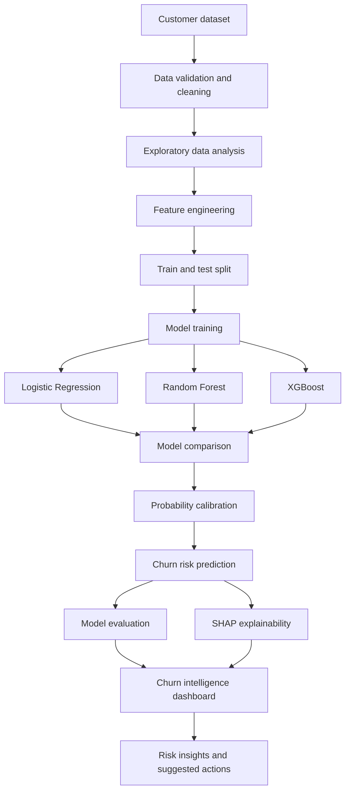

<div align="center">

# Customer Churn Intelligence

### Explainable and uncertainty-aware customer churn prediction

**Python · Research-oriented AI · Reproducible experiments**


</div>

---

## Overview

A reproducible machine-learning workflow examining churn prediction beyond headline accuracy, with attention to class imbalance, probability calibration, and interpretable model outputs.

This repository is being developed as part of a portfolio exploring **reliable, explainable, and evidence-aware AI systems**. The current README describes the intended scope and methodology. Features are marked complete only after they have been implemented and tested.

## Problem statement

A model can rank customers effectively while producing poorly calibrated probabilities. In churn settings, the consequences of missed churners and unnecessary retention interventions may differ, so model assessment should reflect more than accuracy alone.

## Research question

> How do churn models compare when evaluated not only by ranking performance, but also by probability calibration and the practical costs of false-positive and false-negative decisions?

## Objectives

- [ ] Dataset inspection, missing-value analysis, and leakage checks
- [ ] Stratified train/validation/test split and cross-validation where appropriate
- [ ] Logistic Regression baseline
- [ ] Random Forest and XGBoost comparison
- [ ] Class-imbalance-aware evaluation
- [ ] Probability calibration and uncertainty-aware reporting
- [ ] SHAP-based global and individual explanations
- [ ] Transparent rule-based retention suggestions

## Proposed methodology

The project will be developed through explicit baselines, documented implementation choices, and evaluation on a defined dataset or test collection. The exact experimental configuration and results will be added after implementation and validation.

## System architecture

The following diagram represents the **planned** system flow, not a claim that every component is already implemented.



## Evaluation strategy

- Report ROC-AUC and PR-AUC alongside precision, recall, F1, and confusion matrix
- Assess calibration with Brier score and calibration curves
- Keep the final test set untouched during model selection
- Compare models under clearly stated decision thresholds
- Review feature contributions without presenting correlation as causation

Evaluation results will be reported with dataset provenance, split strategy, relevant metrics, and representative failure cases. No performance figures are claimed in this initial scaffold.

## Technology stack

Python, Streamlit, pandas, NumPy, scikit-learn, XGBoost, SHAP, matplotlib, joblib

## Repository structure

```text
customer-churn-intelligence/
├── app.py                  # Streamlit entry point
├── src/
│   └── churn_intelligence/
│       └── __init__.py
├── data/                   # Local datasets; large/private data excluded from Git
├── reports/                # Experiment protocols and evaluation reports
├── assets/
│   └── screenshots/        # Add genuine application screenshots here
├── tests/                  # Automated tests
├── requirements.txt
├── .env.example
├── .gitignore
├── CONTRIBUTING.md
├── LICENSE
└── README.md
```

## Getting started

### Prerequisites

- Python 3.10 or newer (verify package-specific compatibility during setup)
- Git
- A virtual environment

### Clone

```bash
git clone https://github.com/itirksnasingh/customer-churn-intelligence.git
cd customer-churn-intelligence
```

### Create a virtual environment

**Windows PowerShell**
```powershell
python -m venv .venv
.venv\Scripts\Activate.ps1
```

**macOS / Linux**
```bash
python -m venv .venv
source .venv/bin/activate
```

### Install dependencies and run

```bash
python -m pip install --upgrade pip
pip install -r requirements.txt
streamlit run app.py
```

The current app is an informational scaffold. Core project workflows will be added as development progresses.

## Development roadmap

- [ ] Repository scaffold and project documentation
- [ ] Dataset provenance and exploratory analysis
- [ ] Leakage-safe preprocessing and split strategy
- [ ] Baseline and tree-based model comparison
- [ ] Calibration and threshold analysis
- [ ] SHAP explanations and error analysis
- [ ] Dashboard and reproducible inference pipeline
- [ ] Deployment and model card

## Limitations and responsible use

- Predictive associations do not establish causal reasons for churn.
- Performance depends on dataset provenance, representativeness, and label quality.
- Calibration may shift when the customer population or time period changes.
- Retention suggestions are rule-based hypotheses unless tested through an appropriate intervention study.

## Current status

| Area | Status |
|---|---|
| Project scope and research question | Defined |
| Repository scaffold and documentation | Prepared |
| Core implementation | In progress |
| Evaluation and results | Pending |
| Deployment | Pending |

## Reproducibility and data policy

- Record dataset name, source, version, and license.
- Do not commit private, sensitive, or unlicensed data.
- Keep credentials in local environment variables or hosting secrets.
- Record model versions, random seeds, preprocessing, and evaluation configuration.
- Distinguish measured results from hypotheses and planned work.

## Author

**Sanskriti Singh**  
B.Tech Computer Science (AI/ML)  
Bharati Vidyapeeth (Deemed to be University)

## License

This project is released under the MIT License. Dataset, pretrained-model, and third-party component licenses remain subject to their respective terms.
